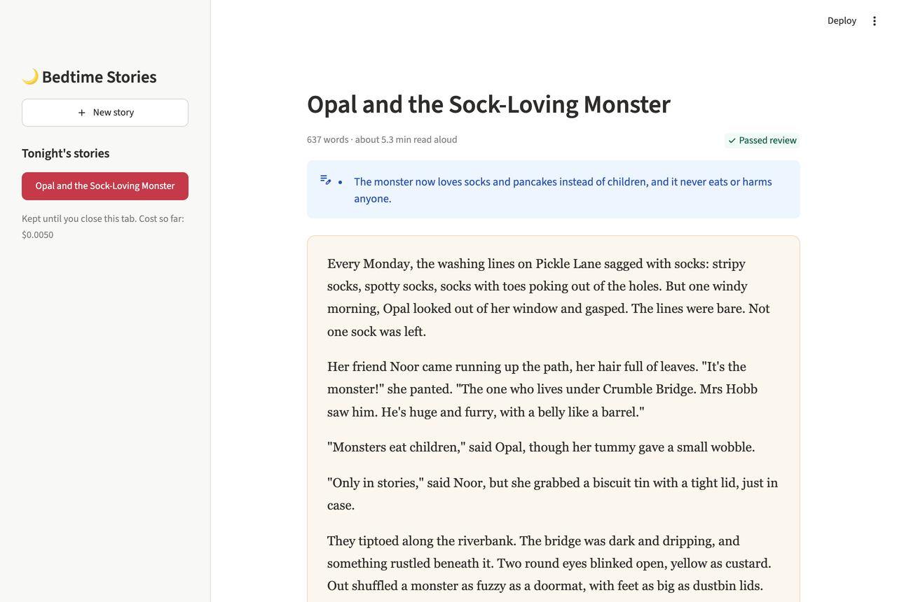
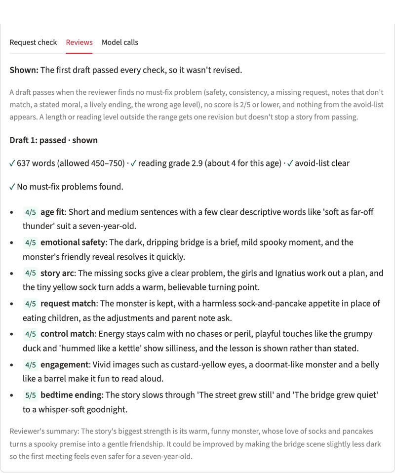
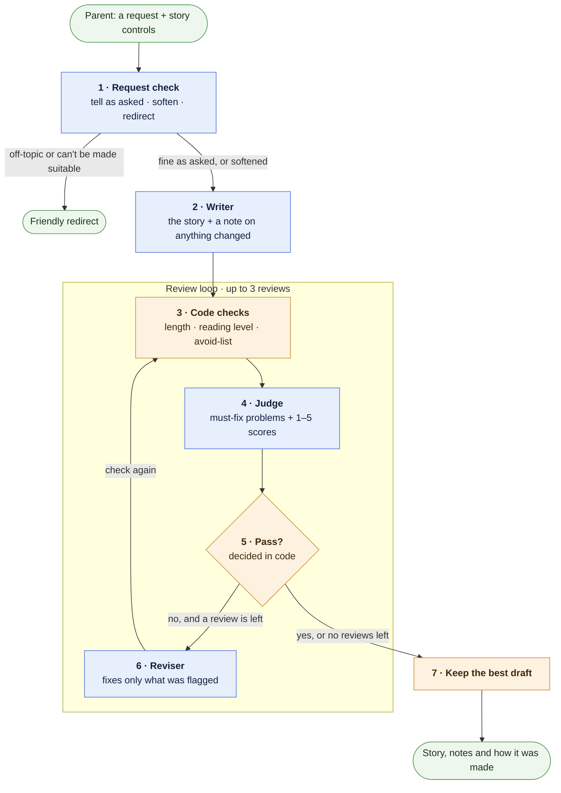
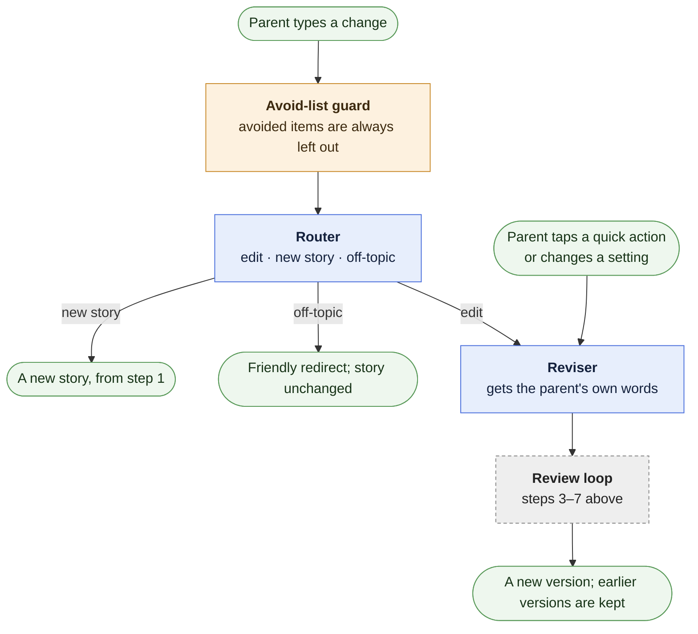

# Bedtime Stories

Turns a simple request ("a dragon who is afraid of the dark") into a bedtime story for children aged 5–10. A writer drafts the story, plain code checks what can be measured, and an LLM judge looks for the problems a parent would notice; any it finds go back for revision. Then the parent can ask for changes.

**Model:** Claude Haiku 5.5 (`claude-haiku-5-5`), as specified in the assignment instructions (in place of GPT-3.5 Turbo in the original brief).



## Quickstart

Requires Python 3.11 or later and an Anthropic API key.

```bash
python3 -m venv .venv
source .venv/bin/activate            # Windows: .venv\Scripts\activate
pip install -r requirements.txt
cp .env.example .env                 # then paste your key after ANTHROPIC_API_KEY=
streamlit run app.py
```

The key is read only from the environment or `.env` (which is gitignored), checked at startup, and never stored or logged. If it's missing or rejected, the app shows what's wrong and how to fix it, with a Retry button.

**Command line**, the same pipeline without the UI:

```bash
python main.py --request "A girl and her cat build a boat to the moon" --name Mia --age 5 --avoid "spiders" -v --trace
```

| Option | What it does |
|---|---|
| `--name`, `--age`, `--pronouns`, `--favorites`, `--avoid` | A child profile: the child becomes the hero, the writing fits their age, favourite things can appear, and avoid-list items never do |
| `--length short\|medium\|long`, `--energy`, `--silliness`, `--lesson` (1–5) | Story controls |
| `-v` | Show each review: must-fix problems and scores |
| `--trace` | Show every model call with tokens, time and cost |

After each story you can type a change ("make the cat grumpy at first"), use a quick action (`shorter`, `funnier`…), or press Enter to finish.

## What it does

- **Any request, kept safe.** Vague requests get a full story. Unsuitable ones are softened rather than refused, keeping their spirit (a monster that eats children becomes one with a harmless taste for socks), and a short note tells the parent what changed. Off-topic requests and prompt injections get a friendly redirect. Real-life worries, such as a new baby or a pet that died, are handled with gentle honesty.
- **Controls that are checked, not just suggested.** Length, Energy, Silliness and Lesson become exact instructions. Code checks length; the judge checks the rest.
- **Follow-ups.** Quick actions (Shorter, Longer, Funnier, Calmer, Simpler words), typed changes, or new settings. Each change is reviewed again and adds a version you can switch back to. A request for a different story starts a new one.
- **"How this story was made".** The request check, every review with the must-fix problems and scores, and every model call with its cost.



## How it works

**A new story**



**A follow-up**



Blue: a call to Claude, each with its own system prompt in `storyteller/prompts/` and a schema-validated reply · amber: plain code · green: what the parent sends and sees.

- **The judge looks for problems, not just quality.** It lists must-fix issues from a fixed checklist (safety, including anything a child might copy; consistency; a missing request; notes that don't match; a stated moral; an ending that isn't calm; the wrong age level), each with the quoted line and a fix. Its 1–5 scores are shown, but **code decides pass/fail**.
- **The judge never sees the writer's prompt,** and the parent's words reach the reviser unchanged.
- **Keep the best draft, not the last one.** Revisions can make a story worse.
- **Every run has a budget:** at most 12 calls, $0.03 and 120 s per story or follow-up.

More detail, including the decisions and known limitations: [docs/DESIGN.md](docs/DESIGN.md).

## Results

A story usually takes 15–40 s (about 35 s on average in the eval) and costs about half a cent.

**Eval** (`python -m eval.run_eval`): 14 requests, including vague, unsafe, off-topic, prompt-injection and real-life ones. It compares the writer's first draft (one well-specified prompt on its own) with the final story after review. Every story is re-checked by two fresh judge calls. Two runs, identical settings:

| | Writer only | With the judge loop |
|---|---|---|
| Must-fix problems per story | 0.42 / 0.42 | **0.15 / 0.27** |
| Pass rate | 62% / 50% | **85% / 73%** |
| Length in range | 85% / 77% | **100% / 100%** |
| Avoid-list hits | 0 | 0 |

**Checking the measurement itself:**
- **Planted problems** (`python -m eval.judge_check`). Hand-written stories each contain one deliberate problem, plus clean ones. The judge caught the problem in 20 of 20 calls with no false alarms. The problems are clear ones; subtle slips are where it's weakest.
- **Fresh requests** (`python -m eval.run_eval --set heldout`). 9 requests written after tuning finished, run once. The writer alone already passed 83% (89% after review), and length was in range for 100% after review.
- **Reading every story.** `python -m eval.qa_run` runs 18 realistic requests and 10 follow-ups and writes each session out, every draft included. Reading them found what the averages hid, and most of the design changes came from that.

## How it was built

The design changed as the measurements came in, and [docs/PROMPT_CHANGELOG.md](docs/PROMPT_CHANGELOG.md) records each step with its numbers, including what didn't work:
- **A planner step was removed** after four eval rounds showed it added cost and no quality.
- **The judge changed from grading taste to listing must-fix problems.** Reading the stories showed it was failing drafts over things like "energy too low", then "too high", while missing a boy climbing a lamppost.
- **A safety fix that made stories preachy was recalibrated.**
- **Small code nudges replaced prompt bans,** for example random name ideas instead of "don't use the name Pip".

## Development

```bash
pip install -r requirements-dev.txt
pytest                      # 51 tests, offline: the LLM is replaced by a scripted fake
ruff check . && ruff format --check .
```

The eval, judge check and QA run make real API calls, costing roughly $0.01–0.15 each.

| Path | Contents |
|---|---|
| `app.py` | Streamlit UI (display only) |
| `main.py` | CLI |
| `storyteller/` | The pipeline: steps, prompts, code checks, pass rule, budget, tracing |
| `eval/` | Eval, judge check, QA run, test requests and results |
| `tests/` | Unit and UI tests |
| `docs/` | [Design](docs/DESIGN.md), [prompt changelog](docs/PROMPT_CHANGELOG.md), [original assignment](docs/ASSIGNMENT.md) |

## Privacy

Nothing about the child is stored: each story is set up on its own and kept only until the browser tab closes. Trace logs in `~/.bedtime-stories/logs/` hold call metadata only (step, tokens, time, cost), never prompts, stories or names.
