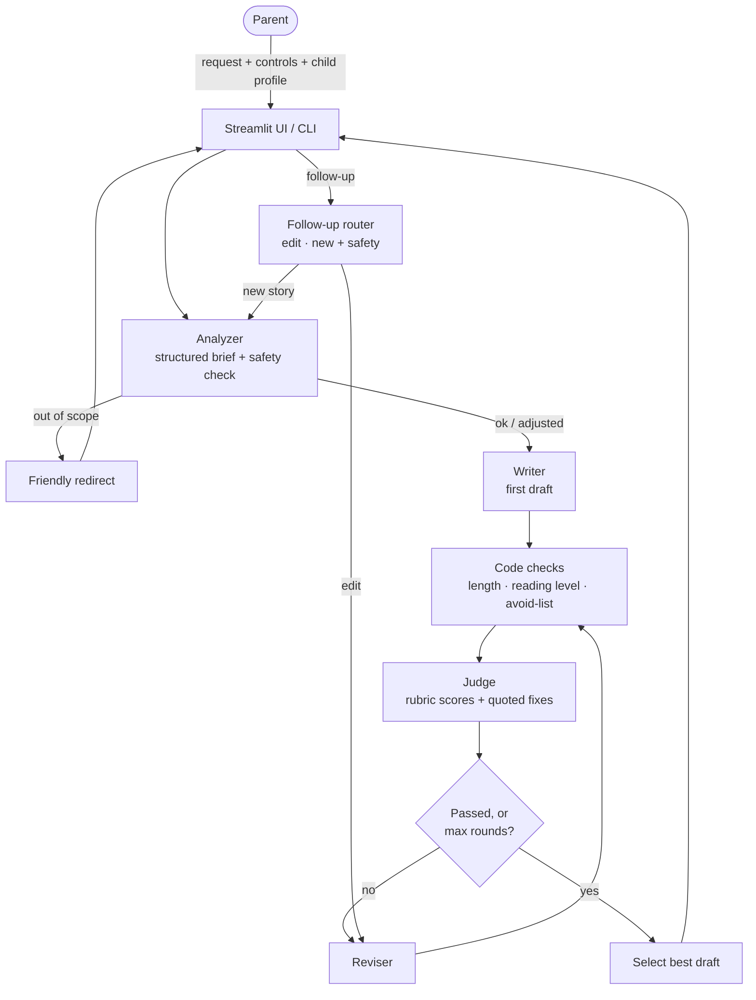

# How it works

A bedtime story generator for ages 5–10. A short request becomes a written, **judged and revised** story. Every model call uses **Claude Haiku 5.5**, so quality comes from the system design rather than model size.

## System

| Step | Job | Why it's a separate step |
|---|---|---|
| **Analyzer** | Turns the request into a structured brief: category, characters, tone, safety status, any changes made | Safety and intent are settled before any writing starts |
| **Writer** | Writes the first draft from one detailed prompt: request, child profile, age guidance, controls and a word budget | Evals showed this single prompt writes as well as a separate plan-then-write step, for less cost |
| **Code checks** | Word count, reading level, avoid-list matches | LLMs are unreliable at counting, and an avoid-list item must never slip through |
| **Judge** | Scores 7 criteria from 1 to 5, quoting the line at fault and suggesting a fix | Specific feedback leads to specific revisions |
| **Reviser** | Fixes only what the judge and code checks flagged | Keeps what works, so a fix in one place doesn't break another |
| **Follow-up router** | Classifies a change request as an edit or a new story, and checks its safety | A follow-up can't push the story below the quality bar |

Each step returns a **schema-validated object** (Pydantic), so no step parses free text.

## Key decisions

- **The judge never sees the writer's prompt.** It grades the story against the original request and the rubric, not against the instructions.
- **Pass/fail is decided in code.** A draft passes when every criterion scores ≥ 4, nothing from the avoid-list appears, the length is within ±15 %, and the reading level isn't above the child's age band. The rule is explicit and tested.
- **Measured, then simplified.** An earlier version had a planner step that outlined the story before writing. Four eval rounds showed it added cost and no quality, so it was removed (details in [PROMPT_CHANGELOG.md](PROMPT_CHANGELOG.md)).
- **Keep the best draft, not the last one.** Revisions can make things worse. There are at most 3 rounds.
- **Every run has a budget.** Each call is bounded (token limit, timeout, retries), and each story or follow-up is capped at 12 calls, $0.03 and 120 s. When a limit is reached, no new revision starts and the best draft so far is returned, with a note.
- **Controls are checked, not just suggested.** Length, Energy, Silliness and Lesson become specific instructions. Code checks length; the judge scores the others.
- **Every story ends calmly,** whatever the Energy level. That's the point of a bedtime story.
- **Soften and explain instead of refusing.** A scary request becomes a gentle version, and the parent is told what changed. Supportive topics, such as a new sibling or moving house, are handled with care.
- **No clarifying questions.** Vague requests get sensible defaults, and the UI shows what was chosen.
- **Text from the user is treated as content, never as instructions.** It's wrapped in XML tags inside every prompt.

## Measuring quality

`eval/run_eval.py` runs 14 test requests, covering vague, unsafe, off-topic and injection attempts and supportive topics. For each request it scores two stories:

- the **writer's first draft**, before any judge feedback: the single-prompt storyteller on its own, which doubles as the baseline
- the **final** story, after the judge loop

The difference shows what the judge loop adds. Every story is re-scored by **two fresh judge calls**, averaged, because the loop keeps its best-scoring draft and its own scores are biased upward. The report also measures the judge's own consistency, plus pass rate, code checks, latency and cost. Each prompt change and its scores are recorded in [PROMPT_CHANGELOG.md](PROMPT_CHANGELOG.md).

Every model call is traced (time, step, attempt, tokens, latency, cost, stop reason, error) and saved as a JSON Lines log in `~/.bedtime-stories/logs/`. Logs hold call metadata only, never prompts, story text or child details. `python main.py --trace` prints the call timeline after each story, and the same data powers the app's "How this story was made" panel.

## Safety and privacy

- The API key comes only from the environment or `.env`. It's checked at startup and never stored or logged.
- The child profile and settings live in `~/.bedtime-stories/`, outside the repo. Only what a story needs is sent to the API.

## Known limitations

- The same judge scores the stories it helped revise, and the prompts are tuned against that judge. The code checks and reading the stories ourselves are the counterweight.
- With 13 scored cases, the judge's own noise (the two calls disagree on pass/fail for about 1 story in 4) is as large as many differences between versions. Mean scores and code checks are more reliable than pass rate.
- The app judges each round with one call, for speed, which is more lenient than the eval's averaged judging.
- Reading-level formulas are noisy on children's stories, so reading level triggers a simplifying revision but isn't a quality score.
