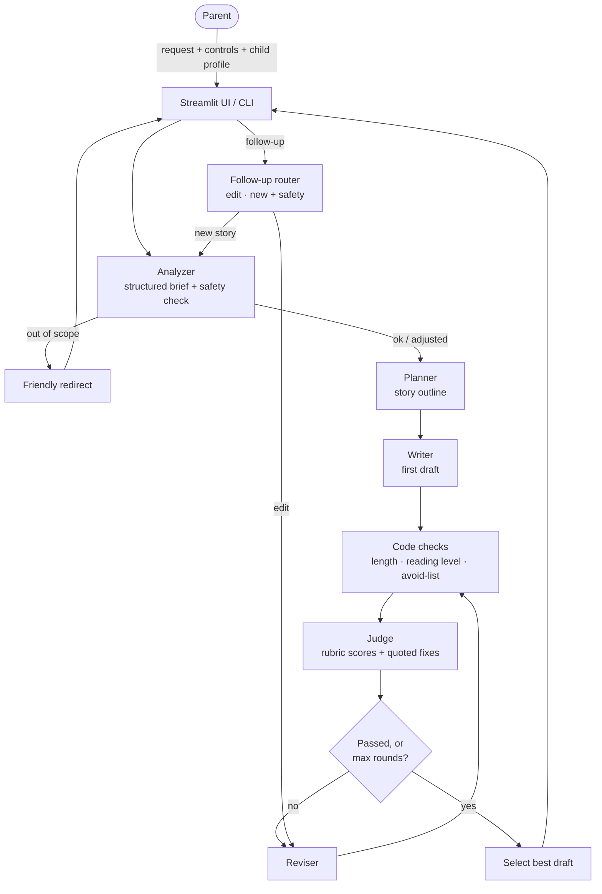

# How it works

A bedtime story generator for ages 5–10. A short request becomes a planned, written, **judged and revised** story. Every model call uses **Claude Haiku 5.5**, so quality comes from the system design rather than model size.

## System

| Step | Job | Why it's a separate step |
|---|---|---|
| **Analyzer** | Turns the request into a structured brief: category, characters, tone, safety status, any changes made | Safety and intent are settled before any writing starts |
| **Planner** | Outlines the story: problem, 3–5 beats, resolution, calm closing | Small models wander when writing freely; a plan fixes the structure first |
| **Writer** | Writes the story from the outline | One focused job: good prose for the child's age and the chosen controls |
| **Code checks** | Word count, reading level, avoid-list matches | LLMs are unreliable at counting, and an avoid-list item must never slip through |
| **Judge** | Scores 7 criteria from 1 to 5, quoting the line at fault and suggesting a fix | Specific feedback leads to specific revisions |
| **Reviser** | Fixes only what the judge flagged | Keeps what works, so a fix in one place doesn't break another |
| **Follow-up router** | Classifies a change request as an edit or a new story, and checks its safety | A follow-up can't push the story below the quality bar |

Each step returns a **schema-validated object** (Pydantic), so no step parses free text.

## Key decisions

- **The judge never sees the writer's prompt.** It grades the story against the original request and the rubric, not against the instructions.
- **Pass/fail is decided in code.** A draft passes when every criterion scores ≥ 4, nothing from the avoid-list appears, and the length is within ±15 %. The rule is explicit and tested.
- **Keep the best draft, not the last one.** Revisions can make things worse. There are at most 3 rounds.
- **Controls are checked, not just suggested.** Length, Energy, Silliness and Lesson become specific instructions. Code checks length; the judge scores the others.
- **Every story ends calmly,** whatever the Energy level. That's the point of a bedtime story.
- **Soften and explain instead of refusing.** A scary request becomes a gentle version, and the parent is told what changed. Supportive topics, such as a new sibling or moving house, are handled with care.
- **No clarifying questions.** Vague requests get sensible defaults, and the UI shows what was chosen.
- **Text from the user is treated as content, never as instructions.** It's wrapped in XML tags inside every prompt.

## Measuring quality

`eval/run_eval.py` runs 12–15 test requests through a **well-written single-prompt baseline** and through **the full pipeline**. The test set includes vague, tricky and inappropriate requests and supportive topics. The report compares rubric scores, pass rate, code checks, latency and cost.

Every model call is traced (step, tokens, latency, cost, stop reason). The same data powers the app's "How this story was made" panel.

## Safety and privacy

- The API key comes only from the environment or `.env`. It's checked at startup and never stored or logged.
- The child profile and settings live in `~/.bedtime-stories/`, outside the repo. Only what a story needs is sent to the API.

## Known limitations

- The same judge scores the baseline and the pipeline, and the pipeline is tuned against that judge. The code checks and reading the stories ourselves are the counterweight.
- Reading-level formulas are noisy on children's stories, so reading level is advisory, not a pass/fail rule.
