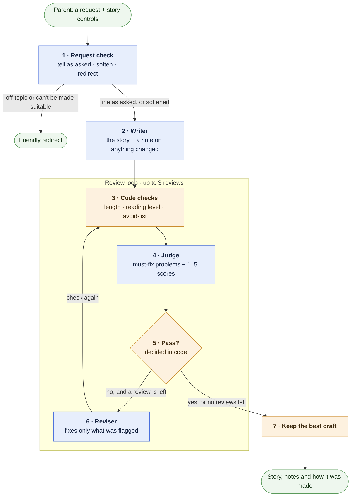
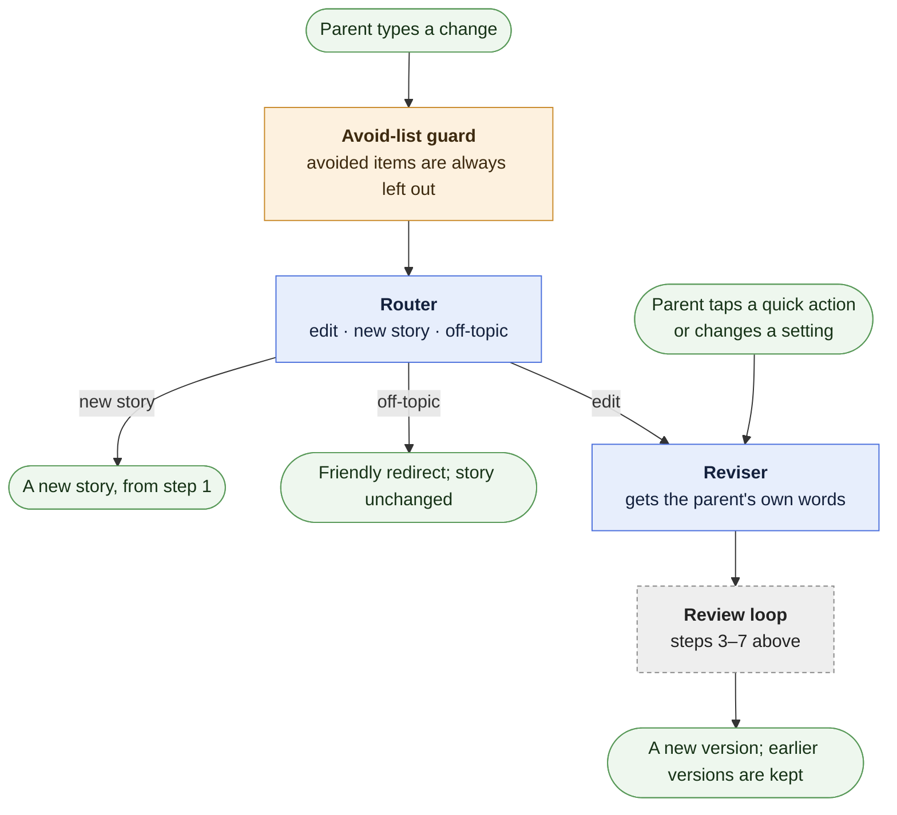

# How it works

A bedtime story generator for ages 5–10. A short request becomes a written, **reviewed and revised** story. Every model call uses **Claude Haiku 5.5**, so quality comes from the system design rather than model size.

## System

**A new story**

**A follow-up**

Blue: a call to Claude, each with its own system prompt in `storyteller/prompts/` and a schema-validated reply · amber: plain code · green: what the parent sends and sees.

| Step | Job | Why it's a separate step |
|---|---|---|
| **Request check** | Decides whether to tell the request as asked, soften it, or redirect it, and lists what must be softened | Safety is settled before any writing starts, and off-topic requests get a reply in about a second |
| **Writer** | Writes the story from one detailed prompt (request, child profile, age guidance, controls, word budget, what to soften), plus a note for the parent on anything it changed | Evals showed one good prompt writes as well as a plan-then-write pipeline. The writer makes every creative choice, so its notes always match the story |
| **Code checks** | Word count, reading level, avoid-list matches | LLMs are unreliable at counting, and an avoid-list item must never slip through |
| **Judge** | Lists must-fix problems from a fixed checklist, each with the quoted line and a fix, and scores 7 criteria from 1 to 5 | A concrete checklist catches what a parent would notice; the scores are for display and the eval |
| **Reviser** | Fixes only what was flagged, or applies the parent's change in their own words | Keeps what works, so a fix in one place doesn't break another |
| **Follow-up router** | Classifies a follow-up as an edit, a new story or off-topic, and says what to soften | It only classifies: the parent's own words go to the reviser, so nothing is lost in a paraphrase |

Each step returns a **schema-validated object** (Pydantic), so no step parses free text.

## Key decisions

- **The judge looks for problems, not just quality.** A draft goes back for revision only for a concrete problem a parent would notice: something unsafe (including behavior a child might copy), an inconsistency, a missing request, notes that don't match, a stated moral when the Lesson setting forbids one, a lively ending, or the wrong age level. Its 1–5 scores are shown but only fail a draft at 2 or below. An earlier version passed a draft only when all 7 scores were at least 4. Testing showed that the judge spent its rounds on matters of taste ("energy too low", then "too high") and missed real mistakes.
- **Pass/fail is decided in code**, from the judge's list and the avoid-list check. Length (±25 %) and a reading level clearly above the age band get a revision, but don't stop a good story from passing. The rule is explicit and tested.
- **The parent's words travel unchanged.** No step paraphrases another step's input. A paraphrase once turned "make the pigeon a boy named Pip" into a human boy climbing a lamppost. A follow-up whose story comes back unchanged is caught in code and sent back.
- **Notes appear only when something was changed** (a request softened, an avoid-list item left out), and the writer writes them, so they describe the story actually written.
- **Measured, then simplified.** A planner step and a long analyzer brief were removed after evals showed they added cost and no quality ([PROMPT_CHANGELOG.md](PROMPT_CHANGELOG.md)).
- **Keep the best draft, not the last one,** with up to 3 reviews. Most stories pass in one or two; a third runs only when a must-fix problem is still left.
- **Every run has a budget.** Each call is bounded (token limit, timeout, retries), and each story or follow-up is capped at 12 calls, $0.03 and 120 s. When a limit is reached, the best draft so far is returned, with a note.
- **Controls are checked, not just suggested.** Length, Energy, Silliness and Lesson become specific instructions. Code checks length; the judge checks the others.
- **Every story ends calmly,** whatever the Energy level. That's the point of a bedtime story.
- **Safe without being preachy.** Safety rules cover what's genuinely dangerous if a child copied it (leaving home at night, the stove, strangers, secrets from parents). Ordinary independence is fine, and fixes keep the child's own solution instead of handing it to a grown-up.
- **Small code nudges beat prompt bans.** The writer gets 5 random name ideas, because the model otherwise reuses the same few names and a ban made it correct itself mid-story. The story is generated before its title, so the title can't name a character who isn't in it.
- **Soften instead of refusing.** A scary request keeps its spooky feel with a friendly reveal, and a monster that eats people stays a monster, with a harmless appetite. Real-life topics, such as a new school or a pet that died, are handled with care.
- **Text from the user is treated as content, never as instructions.** It's wrapped in XML tags inside every prompt.

## Measuring quality

Two complementary checks:

- **`eval/run_eval.py`** runs 14 test requests, covering vague, unsafe, off-topic and injection attempts and supportive topics. For each request it scores the **writer's first draft** (the single prompt on its own, which doubles as the baseline) and the **final** story after the review loop. Every story is re-checked by **two fresh judge calls**. The headline number is **must-fix problems per story**, with pass rate, scores, the judge's own consistency, latency and cost.
- **Reading the stories.** `eval/qa_run.py` runs 18 realistic requests and 10 follow-ups through the app's pipeline and writes every session out for reading, with each later draft as a word diff (the output is not committed). Every story and every intermediate draft was read in full. This found what the averages hid (the pigeon, a renamed family dog, a follow-up that changed nothing, judge fixes that created contradictions, over-cautious safety fixes) and led to the current design.

- **Checking the checker.** `eval/judge_check.py` runs the judge on hand-written stories with one planted problem each, plus clean ones: it caught the planted problem in 20 of 20 calls with no false alarms. `run_eval.py --set heldout` runs 9 requests written after tuning finished, once.

Each prompt change and its results are recorded in [PROMPT_CHANGELOG.md](PROMPT_CHANGELOG.md).

Every model call is traced (time, step, attempt, tokens, latency, cost, stop reason, error) and saved as a JSON Lines log in `~/.bedtime-stories/logs/`. Logs hold call metadata only, never prompts, story text or child details. `python main.py --trace` prints the call timeline after each story, and the same data powers the app's "How this story was made" panel.

## The app

`streamlit run app.py` opens the story screen.
- **The basics:** the parent types an idea or picks an example, adjusts the controls if they want, and watches each step live.
- **The story view:** the story, a note when something was changed, and a "Passed review" or "Best effort" badge.
- **Follow-ups:** quick actions (Shorter, Funnier…), typed changes or new settings. Each one is reviewed again and adds a version, and earlier versions stay readable.
- **"How this story was made":** the request check, every review with its must-fix problems and scores, and every model call with its cost.

Every story is set up on its own: the parent picks the controls for tonight's story, and nothing is stored between sessions, so the app keeps no data about the child. A child profile (name, age, pronouns, favorite things, things to avoid, whether the child is the hero) is supported by the pipeline and set per run through the CLI (`--name Mia --age 5 --avoid spiders`).

The UI only displays results: the pipeline package is shared with the CLI, and the UI is tested headless with the same fake LLM as the pipeline.

## Safety and privacy

- The API key comes only from the environment or `.env`. It's checked at startup and never stored or logged.
- Trace logs live in `~/.bedtime-stories/`, outside the repo, and hold no story text or child details. Only what a story needs is sent to the API.

## Known limitations

- The same judge reviews the stories it helped revise, and the prompts are tuned against that judge. Reading every story and draft ourselves, and the code checks, are the counterweight.
- Results vary a lot from run to run: with identical settings, two eval runs found 0.15 and 0.27 must-fix problems per final story. Small differences between versions are noise.
- The judge is inconsistent from call to call: the same line can be flagged in one review and not the next. The app uses one judge call per review, for speed, so some problems still reach the parent, most often a stated moral.
- Safety judgment is a balance. The rules were tightened after a child was shown sneaking out at night, then loosened after they made stories preachy; occasional over-cautious flags remain.
- The reading-level formula only works for English and is noisy on children's stories, so it only triggers a revision when a story is clearly too hard.
